## B1: Runtime Worlds

### World assignment

| World | Files | chrome.* access | window.VSC access | DOM access |
|---|---|---|---|---|
| (b) Content script isolated world | `src/content/injector.js` | Full (`chrome.storage`, `chrome.runtime`) | None (injector does not write to window.VSC) | Yes — injects `<script>` and `<link>` tags, listens on `window` for custom events |
| (a) Page main world (injected scripts) | `src/utils/constants.js`, `src/utils/logger.js`, `src/utils/debug-helper.js`, `src/utils/dom-utils.js`, `src/utils/event-manager.js`, `src/core/storage-manager.js`, `src/core/settings.js`, `src/observers/media-observer.js`, `src/observers/mutation-observer.js`, `src/core/action-handler.js`, `src/core/video-controller.js`, `src/ui/controls.js`, `src/ui/drag-handler.js`, `src/ui/shadow-dom.js`, `src/site-handlers/base-handler.js`, `src/site-handlers/netflix-handler.js`, `src/site-handlers/youtube-handler.js`, `src/site-handlers/facebook-handler.js`, `src/site-handlers/amazon-handler.js`, `src/site-handlers/apple-handler.js`, `src/site-handlers/index.js`, `src/lib/gifuct-js.min.js`, `src/core/gif-frame-engine.js`, `src/observers/gif-observer.js`, `src/core/gif-controller.js`, `src/content/inject.js` | None (no `chrome.*`) | Full read/write (all window.VSC.* globals) | Full |
| (c) MV3 service worker | `src/background.js` | Full (`chrome.action`, `chrome.runtime`, `chrome.tabs`) | None | None |
| (d) Extension pages — options | `src/ui/options/options.html` + `options.js` | `chrome.storage` (via StorageManager) | Full (creates `window.VSC.videoSpeedConfig`) | Yes (options page DOM) |
| (d) Extension pages — popup | `src/ui/popup/popup.html` + popup JS | `chrome.runtime.sendMessage` to content script | None directly | Yes (popup DOM) |
| (d) Extension pages — gif-file-fetcher iframe | `src/gif-file-fetcher.js` (loaded inside `src/gif-file-fetcher.html`) | None (`chrome-extension://` origin only for CORS) | None | Minimal (no page DOM) |

OBSERVED: injector.js:37–63@e904370 (module list), manifest.json:37–56@e904370 (content_scripts), manifest.json:22–24@e904370 (service_worker), manifest.json:25–36@e904370 (options_ui, action).

### Crossing points

Every seam between worlds uses one of three transports:

| # | Crossing | Direction | Sender world | Receiver world | Mechanism | Verified |
|---|---|---|---|---|---|---|
| 1 | `VSC_USER_SETTINGS` | isolated → main | `injector.js:283` | `storage-manager.js:17` | `window.dispatchEvent(new CustomEvent(...))` then `window.addEventListener` | OBSERVED |
| 2 | `VSC_SAVE_SETTINGS` | main → isolated | `storage-manager.js:109` | `injector.js:144` | `window.dispatchEvent(new CustomEvent(...))` then `window.addEventListener` | OBSERVED |
| 3 | `VSC_MESSAGE` | isolated → main | `injector.js:132` (bridges from popup via `chrome.runtime.onMessage`) | `inject.js:476` | `window.dispatchEvent(new CustomEvent(...))` then `window.addEventListener` | OBSERVED |
| 4 | `VSC_CONTROLLER_CREATED` | main → isolated | `gif-controller.js:321`, `video-controller.js:418` | `injector.js:235` | `window.dispatchEvent(new CustomEvent(...))` then `window.addEventListener` | OBSERVED |
| 5 | `VSC_CONTROLLER_REMOVED` | main → isolated | `gif-controller.js:793` | `injector.js:253` | `window.dispatchEvent(new CustomEvent(...))` then `window.addEventListener` | OBSERVED |
| 6 | `VSC_FETCH_GIF_BYTES` | main → isolated | `gif-controller.js:391` | `injector.js:222` | `window.dispatchEvent(new CustomEvent(...))` then `window.addEventListener` | OBSERVED |
| 7 | `VSC_GIF_FETCH_REQUEST` | isolated → gif-file-fetcher iframe | `injector.js:203` | `gif-file-fetcher.js:14` | `iframe.contentWindow.postMessage(...)` | OBSERVED |
| 8 | `VSC_GIF_BYTES_RESPONSE` | gif-file-fetcher iframe → main world | `gif-file-fetcher.js:33,39,48,55,64` | `gif-controller.js:364` | `window.parent.postMessage(...)` received by `window.addEventListener('message')` | OBSERVED |
| 9 | `VSC_GIF_FETCHER_READY` | gif-file-fetcher iframe → isolated | `gif-file-fetcher.js:72` | `injector.js:215` | `window.parent.postMessage(...)` then `window.addEventListener('message')` | OBSERVED |
| 10 | `VSC_CONTROLLER_CREATED` | isolated → service worker | `injector.js:239` | `background.js:66` | `chrome.runtime.sendMessage` / `chrome.runtime.onMessage` | OBSERVED |
| 11 | `VSC_CONTROLLER_REMOVED` | isolated → service worker | `injector.js:257` | `background.js:78` | `chrome.runtime.sendMessage` / `chrome.runtime.onMessage` | OBSERVED |
| 12 | `VSC_QUERY_ACTIVE_CONTROLLERS` | popup → service worker | popup JS (unverified) | `background.js:95` | `chrome.runtime.sendMessage` / `chrome.runtime.onMessage` | OBSERVED receiver only |
| 13 | Popup → isolated → main (speed commands) | popup → service worker → isolated → main | popup JS | `injector.js:128` bridges to `inject.js:476` via `VSC_MESSAGE` | `chrome.runtime.sendMessage` + `CustomEvent('VSC_MESSAGE')` | OBSERVED relay |

Note: Netflix site handler uses an additional `window.postMessage` (netflix-handler.js:44) directed at Netflix's own player — this is a site-specific adapter, not a VSC protocol crossing.

---

## B2: window.VSC Registry and Module Graph

### window.VSC globals registry

Every property registered on `window.VSC` in the production injection path:

| Global | Type | Registered in file | Line@base-sha | Consumed by |
|---|---|---|---|---|
| `window.VSC` (namespace) | Object | `src/utils/constants.js` (first writer), each module guards with `\|\|{}` | constants.js:1@e904370 | All modules |
| `window.VSC.Constants` | Object (constants/enums) | `src/utils/constants.js` | constants.js:9@e904370 | settings.js, action-handler.js, gif-controller.js, gif-frame-engine.js, gif-observer.js, inject.js |
| `window.VSC.logger` | Logger instance | `src/utils/logger.js` | logger.js:107@e904370 | All modules |
| `window.VSC.DebugHelper` | Class | `src/utils/debug-helper.js` | debug-helper.js:397@e904370 | Not consumed by production path (dev/debug tool) |
| `window.VSC.DomUtils` | Object (functions) | `src/utils/dom-utils.js` | dom-utils.js:7@e904370 | inject.js, mutation-observer.js, action-handler.js |
| `window.VSC.EventManager` | Class | `src/utils/event-manager.js` | event-manager.js:319@e904370 | inject.js:25 |
| `window.VSC.StorageManager` | Class (static methods) | `src/core/storage-manager.js` | storage-manager.js:163@e904370 | settings.js |
| `window.VSC.videoSpeedConfig` | VideoSpeedConfig instance | `src/core/settings.js` | settings.js:304@e904370 | inject.js:37, inject.js:495 |
| `window.VSC.VideoSpeedConfig` | Class (constructor) | `src/core/settings.js` | settings.js:307@e904370 | options.js:314,373,495 |
| `window.VSC.MediaElementObserver` | Class | `src/observers/media-observer.js` | media-observer.js:290@e904370 | inject.js:31 |
| `window.VSC.VideoMutationObserver` | Class | `src/observers/mutation-observer.js` | mutation-observer.js:351@e904370 | inject.js:30 |
| `window.VSC.ActionHandler` | Class | `src/core/action-handler.js` | action-handler.js:566@e904370 | inject.js:24 |
| `window.VSC.VideoController` | Class | `src/core/video-controller.js` | video-controller.js:430@e904370 | inject.js:23 |
| `window.VSC.ControlsManager` | Class | `src/ui/controls.js` | controls.js:131@e904370 | video-controller.js, gif-controller.js |
| `window.VSC.DragHandler` | Object/Class | `src/ui/drag-handler.js` | drag-handler.js:60@e904370 | action-handler.js:163,277 |
| `window.VSC.ShadowDOMManager` | Class | `src/ui/shadow-dom.js` | shadow-dom.js:248@e904370 | video-controller.js:108, gif-controller.js:606 |
| `window.VSC.BaseSiteHandler` | Class | `src/site-handlers/base-handler.js` | base-handler.js:96@e904370 | site handler subclasses |
| `window.VSC.NetflixHandler` | Class | `src/site-handlers/netflix-handler.js` | netflix-handler.js:100@e904370 | site-handlers/index.js |
| `window.VSC.YouTubeHandler` | Class | `src/site-handlers/youtube-handler.js` | youtube-handler.js:120@e904370 | site-handlers/index.js |
| `window.VSC.FacebookHandler` | Class | `src/site-handlers/facebook-handler.js` | facebook-handler.js:142@e904370 | site-handlers/index.js |
| `window.VSC.AmazonHandler` | Class | `src/site-handlers/amazon-handler.js` | amazon-handler.js:69@e904370 | site-handlers/index.js |
| `window.VSC.AppleHandler` | Class | `src/site-handlers/apple-handler.js` | apple-handler.js:60@e904370 | site-handlers/index.js |
| `window.VSC.siteHandlerManager` | SiteHandlerManager instance | `src/site-handlers/index.js` | index.js:128@e904370 | inject.js:29 |
| `window.VSC.GifFrameCache` | Object (memory budget tracker) | `src/core/gif-frame-engine.js` | gif-frame-engine.js:10@e904370 | gif-controller.js:140,151,159,285,333,763 |
| `window.VSC.GifFrameEngine` | Class (static only) | `src/core/gif-frame-engine.js` | gif-frame-engine.js:47@e904370 | gif-controller.js:526 |
| `window.VSC.gifFetchFailCache` | Map | `src/observers/gif-observer.js` | gif-observer.js:10@e904370 | gif-controller.js:82,87,407,429 |
| `window.VSC.GifObserver` | Object (3 functions) | `src/observers/gif-observer.js` | gif-observer.js:56@e904370 | gif-controller.js:59, mutation-observer.js:112,238 |
| `window.VSC.GifController` | Class | `src/core/gif-controller.js` | gif-controller.js:804@e904370 | inject.js:370 |
| `window.__VSC_gifuct` | Object (vendor lib: parseGIF, decompressFrames) | `src/lib/gifuct-js.min.js` | gifuct-js.min.js:4@e904370 | gif-controller.js:108,147,664,665 |
| `window.VideoSpeedExtension` | Class (test export) | `src/content/inject.js` | inject.js:604@e904370 | E2E tests only |
| `window.videoSpeedExtension` | Instance (test export) | `src/content/inject.js` | inject.js:605@e904370 | E2E tests, debug-helper.js:84 |
| `window.VSC_MODULES` | Object | `src/module-loader.js` | module-loader.js:6@e904370 | Not used by any production module (dead code) |
| `window.defineModule` | Function | `src/module-loader.js` | module-loader.js:15@e904370 | Not used by any production module (dead code) |
| `window.loadModule` | Function | `src/module-loader.js` | module-loader.js:39@e904370 | Not used by any production module (dead code) |

### Module load order comparison

injector.js injects scripts sequentially (await each). The declared order vs. test helper order:

| # | injector.js order (OBSERVED: injector.js:37–63) | tests/helpers/module-loader.js order (OBSERVED: module-loader.js:12–41) | Agreement |
|---|---|---|---|
| 1 | src/utils/constants.js | src/utils/constants.js | YES |
| 2 | src/utils/logger.js | src/utils/logger.js | YES |
| 3 | src/utils/debug-helper.js | (absent) | NO — tests omit debug-helper |
| 4 | src/utils/dom-utils.js | src/utils/dom-utils.js | YES |
| 5 | src/utils/event-manager.js | src/utils/event-manager.js | YES |
| 6 | src/core/storage-manager.js | src/core/storage-manager.js | YES |
| 7 | src/core/settings.js | src/core/settings.js | YES |
| 8 | src/observers/media-observer.js | (deferred to end, #13) | ORDER differs |
| 9 | src/observers/mutation-observer.js | (deferred to end, #14) | ORDER differs |
| 10 | src/core/action-handler.js | src/site-handlers/base-handler.js | ORDER differs |
| 11 | src/core/video-controller.js | … all site handlers … | ORDER differs |
| 12–19 | src/ui/*, src/site-handlers/* | src/core/action-handler.js, src/core/video-controller.js | ORDER differs |
| 20–24 | src/lib/gifuct-js.min.js, gif-frame-engine.js, gif-observer.js, gif-controller.js | (absent from loadCoreModules; added in loadGifModules) | PARTIAL |
| 25 | src/content/inject.js | src/content/inject.js (only in loadInjectModules) | YES |

manifest.json `web_accessible_resources` uses glob patterns (`src/core/*.js`, `src/utils/*.js`, etc.) — it does not encode a specific load order. The patterns cover all files listed in injector.js. OBSERVED: manifest.json:58–80@e904370.

INFERRED: The test helper load order divergence (observers loaded after controllers in tests, before in production) is safe only because all consumers read window.VSC.* lazily at call time, not at script parse time. Any module that captures a reference at the top-level of the script would break.

### module-loader.js status

OBSERVED: `src/module-loader.js` is listed as a `web_accessible_resource` (manifest.json:63) and is NOT in the injector.js module array (injector.js:37–63). It is never injected by injector.js. Its three globals (`window.VSC_MODULES`, `window.defineModule`, `window.loadModule`) have no callers in any src/ file. It is dead code in the production path.

---

## B3: Protocol and Contract Catalog

### Custom event / message protocol

| Event / Message | Direction | Sender file:line | Receiver file:line | Verified? |
|---|---|---|---|---|
| `CustomEvent('VSC_USER_SETTINGS')` | injector → page (main world) | injector.js:283 | storage-manager.js:17 | OBSERVED both sides |
| `CustomEvent('VSC_SAVE_SETTINGS')` | page → injector | storage-manager.js:109 | injector.js:144 | OBSERVED both sides |
| `CustomEvent('VSC_MESSAGE')` | injector → page | injector.js:132 | inject.js:476 | OBSERVED both sides |
| `CustomEvent('VSC_CONTROLLER_CREATED')` | page → injector | gif-controller.js:321, video-controller.js:418 | injector.js:235 | OBSERVED both sides |
| `CustomEvent('VSC_CONTROLLER_REMOVED')` | page → injector | gif-controller.js:793 | injector.js:253 | OBSERVED both sides |
| `CustomEvent('VSC_FETCH_GIF_BYTES')` | page → injector | gif-controller.js:391 | injector.js:222 | OBSERVED both sides |
| `postMessage({type:'VSC_GIF_FETCH_REQUEST'})` | injector → gif-file-fetcher iframe | injector.js:203 | gif-file-fetcher.js:14 | OBSERVED both sides |
| `postMessage({type:'VSC_GIF_BYTES_RESPONSE'})` | gif-file-fetcher iframe → page window | gif-file-fetcher.js:33,39,48,55,64 | gif-controller.js:364 | OBSERVED both sides |
| `postMessage({type:'VSC_GIF_FETCHER_READY'})` | gif-file-fetcher iframe → injector | gif-file-fetcher.js:72 | injector.js:215 | OBSERVED both sides |
| `chrome.runtime.sendMessage({type:'VSC_CONTROLLER_CREATED'})` | injector → background | injector.js:239 | background.js:66 | OBSERVED both sides |
| `chrome.runtime.sendMessage({type:'VSC_CONTROLLER_REMOVED'})` | injector → background | injector.js:257 | background.js:78 | OBSERVED both sides |
| `chrome.runtime.sendMessage({type:'VSC_QUERY_ACTIVE_CONTROLLERS'})` | popup → background | (popup JS unread) | background.js:95 | OBSERVED receiver only |
| `CustomEvent('ratechange')` | internal (video-controller/action-handler) | video-controller.js:86, action-handler.js:360 | HTMLMediaElement listeners | OBSERVED senders |
| `CustomEvent('VSC_MESSAGE')` via debug-helper | debug → page | debug-helper.js:270 | inject.js:476 | OBSERVED sender |

### VSC_MESSAGE payload types (MESSAGE_TYPES constants)

OBSERVED in inject.js:484–585@e904370. Each case maps to `window.VSC.Constants.MESSAGE_TYPES.*`:

| MESSAGE_TYPE key | Action |
|---|---|
| `SET_SPEED` | Set playback rate on all videos and GIFs |
| `ADJUST_SPEED` | Delta-adjust playback rate |
| `RESET_SPEED` | Reset to 1.0 |
| `TOGGLE_DISPLAY` | Toggle controller overlay visibility |
| `DISABLE_GIF_CONTROL` | Tear down all GIF controllers |
| `ENABLE_GIF_CONTROL` | Scan and attach GIF controllers |

### Expando properties on DOM elements

Every custom property attached directly to DOM elements (not via class or dataset):

| Expando | Element type | Set at | Purpose | Verified |
|---|---|---|---|---|
| `video.vsc` | HTMLVideoElement / HTMLAudioElement | inject.js:321 | Reference to VideoController instance; guard against double-attach | OBSERVED |
| `img.gifController` | HTMLImageElement | inject.js:369, gif-controller.js:277 | Reference to GifController instance (or sentinel object during async create) | OBSERVED |
| `img.vscGifFailed` | HTMLImageElement | inject.js:376 | Boolean flag: GIF fetch/decode failed, do not retry | OBSERVED |
| `img.vscGifIgnore` | HTMLImageElement | gif-controller.js (via teardown), inject.js:362 | Boolean flag: suppress re-attachment after teardown | OBSERVED |
| `img._vscTeardownSrc` | HTMLImageElement | gif-controller.js:766 | Records `img.src` at teardown so src-change watcher knows whether src actually changed | OBSERVED |
| `canvas.vsc` | HTMLCanvasElement | gif-controller.js:293 | Adapter shim `{ div: gc.div }` so DragHandler works on canvas the same way it works on video.vsc | OBSERVED |

---

## B4: State and Lifecycle

### Settings flow

INFERRED from code observations:

1. **Options page save**: options.js calls `window.VSC.videoSpeedConfig.save(newSettings)` which calls `window.VSC.StorageManager.set(data)`. Because options.js runs in an extension page with `chrome.storage` available, `StorageManager.set` writes directly to `chrome.storage.sync`.
2. **Content script reads on load**: `injector.js:injectUserSettings()` runs after all modules are injected. It calls `chrome.storage.sync.get(null)` (injector.js:276) and dispatches `CustomEvent('VSC_USER_SETTINGS', { detail: userSettings })` to the page window.
3. **Page world receives**: `StorageManager._setupSettingsListener()` (storage-manager.js:15) listens for `VSC_USER_SETTINGS` and caches the payload in `StorageManager._injectedSettings`.
4. **Settings.load()**: Detects it is in injected (no `chrome.storage`) context and calls `StorageManager.waitForInjectedSettings()` which polls `_injectedSettings` until available (5 s timeout).
5. **Live updates**: `StorageManager.onChanged` (storage-manager.js:153) is defined but has **zero callers** anywhere in src/ or tests/. VERIFIED by grep returning no output. This means settings changes made in the options page after the content script has initialized are **not propagated** to the running page world.

### GIF Controller lifecycle states

OBSERVED: gif-controller.js:50–805@e904370.

```
[not attached]
    |
    | inject.js:onGifFound() sets img.gifController = sentinel {pending:true}
    v
[PENDING — async create() running]
    |
    | GifController.create(): fetch bytes, parse, decompress, allocate memory, DOM swap
    |   -> failure at any step: returns null, img.vscGifFailed = true
    v
[CREATED — rAF loop running]
    |  states managed internally:
    |    _userPaused (user clicked pause)
    |    _visibilityPaused (IntersectionObserver out-of-view)
    |    _rafRunning (rAF loop active guard)
    |    tab visibility (visibilitychange stops/resumes loop)
    |
    | gc.remove() called (onGifRemoved, cleanup, message DISABLE_GIF_CONTROL)
    v
[TEARDOWN]
    1. Stop rAF loop
    2. Disconnect IntersectionObserver, MutationObserver (targetObserver)
    3. Remove visibilitychange listener
    4. Remove controls overlay (div)
    5. Null frame data, release memory budget (GifFrameCache.releaseAllocation)
    6. Set img._vscTeardownSrc, img.vscGifIgnore = true
    7. Re-insert original img (or undo picture hiding)
    8. Remove canvas from DOM
    9. config.removeGifElement(img), delete img.gifController
   10. Dispatch VSC_CONTROLLER_REMOVED
    v
[not attached]
```

Note: The sentinel object placed at step 1 has a `.remove()` method that sets `_cancelled = true`. If `create()` finishes after `sentinel.remove()` was called, the newly created gc is immediately torn down.

### StorageManager.onChanged — callers

VERIFIED by grep: `grep -rn "StorageManager\.onChanged" src/ tests/` returned **no output**. The method is defined at storage-manager.js:153 but has no callers. Real-time settings change propagation to active content scripts is unimplemented.

---

## B5: Depth Assessment

### Module classification

| Module | LOC | Depth | Dominant logic | Seam notes |
|---|---|---|---|---|
| `src/core/gif-controller.js` | 805 | **DEEP** | Owns: canvas-replacement DOM surgery, rAF animation loop, frame compositing (disposal types 0/1/2/3), memory budget integration, IntersectionObserver, src-mutation watcher, overlay controls, file:// fetch bridge, full teardown | Hard to split without defining an explicit render-pipeline interface. Natural seams: (1) fetch + decode vs. animate; (2) DOM management vs. playback state; (3) overlay/controls vs. animation. |
| `src/content/inject.js` | 611 | **DEEP** | Owns: top-level orchestration (VideoSpeedExtension class), observer wiring, GIF/video found/removed callbacks, popup message dispatch, GIF attach guard logic | Orchestrator depth comes from coordinating many modules. Seam: message handling (lines 476–587) could be a separate adapter module. |
| `src/core/action-handler.js` | 568 | **DEEP** | Owns: all keyboard/click action dispatch, speed clamping, drag handling, GIF speed save debounce, action routing for both video and GIF paths | Seam: GIF-specific action handling was added alongside video; separating `ActionHandler` into video-only and GIF delegates is feasible. |
| `src/utils/event-manager.js` | 319 | **DEEP** | Owns: keyboard event listener setup, keydown routing, scroll-based speed control, event cleanup | Seam: scroll-speed control logic is independent of key binding dispatch. |
| `src/observers/mutation-observer.js` | 351 | MEDIUM | DOM mutation processing, shadow root tracking, GIF src-attribute watching | Seam: GIF-specific attribute mutation handling (lines 102–119) is a separable concern. |
| `src/core/settings.js` | 310 | MEDIUM | VideoSpeedConfig class: load, save, key binding migration, media/GIF element registry | Seam: element registry (addMediaElement etc.) is an unrelated concern mixed with settings persistence. |
| `src/ui/shadow-dom.js` | 248 | MEDIUM | Shadow DOM creation, position calculation, style injection | Moderate logic for cross-browser shadow DOM; reasonably self-contained. |
| `src/utils/dom-utils.js` | 228 | SHALLOW | Pure utility functions (getShadow, isBlacklisted, initializeWhenReady) | Thin adapter; easily replaced or extended. |
| `src/observers/media-observer.js` | 290 | MEDIUM | scanForMedia, scanForGifs, shouldStartHidden, isValidMediaElement | Medium: contains heuristics for size/visibility gating. |
| `src/core/video-controller.js` | 432 | **DEEP** | VideoController class: overlay div creation, speed display, show/hide, ShadowDOM integration, per-video event dispatch | Seam: UI rendering (div/overlay) vs. speed-state management are mixed. |
| `src/core/storage-manager.js` | 164 | SHALLOW | Static wrapper around `chrome.storage.sync` with injected-settings fallback | Thin adapter. |
| `src/core/gif-frame-engine.js` | 48 | SHALLOW | Single static method: `effectiveDelay(rawDelayMs, speed)` + `GifFrameCache` budget object | Easily replaceable; pure functions + simple counter. |
| `src/observers/gif-observer.js` | 57 | SHALLOW | Three pure detection utilities: `isGifSrc`, `isGifElement`, `detectGifsInDOM` | Thin adapter. |
| `src/utils/logger.js` | 110 | SHALLOW | Verbosity-gated console wrapper | Thin adapter. |
| `src/utils/constants.js` | 121 | SHALLOW | Pure data: DEFAULT_SETTINGS, SPEED_LIMITS, MESSAGE_TYPES, GIF constants | Data module. |
| `src/ui/controls.js` | 131 | SHALLOW | ControlsManager: creates button elements, sets speed display text | Thin UI adapter; easily replaced with different UI. |
| `src/ui/drag-handler.js` | 60 | SHALLOW | `handleDrag`: mouse drag logic for overlay repositioning | Small; single responsibility. |
| `src/content/injector.js` | 319 | MEDIUM | Script injection orchestration, message bridge, file:// GIF proxy | Owns critical cross-world protocols; not easily moved but well-scoped. |
| `src/background.js` | 191 | SHALLOW | Tab controller tracking, icon state management | Thin service-worker adapter; no domain logic. |
| `src/module-loader.js` | 71 | SHALLOW (dead) | AMD-style define/load (unused in production) | Dead code; could be removed without impact. |
| `src/site-handlers/` (5 handlers + index) | ~90 LOC each | SHALLOW | Per-site adapter methods (detectSpecialVideos, shouldIgnoreVideo) | Each is a thin adapter over base-handler.js seam. |

### Key identified seams

1. **fetch+decode / animate seam** in gif-controller.js: `_fetchGifBytes` + `create()` frame parsing vs. `_drawFrame` + `_startRafLoop`. These could be split at the ArrayBuffer handoff.
2. **overlay/UI / playback-state seam** in gif-controller.js and video-controller.js: the controller class mixes DOM overlay management with playback bookkeeping. Extracting an overlay module would reduce depth.
3. **message-dispatch seam** in inject.js: lines 476–587 handle popup messages and could be an independent `MessageRouter` module consuming window.VSC globals.
4. **settings persistence / element-registry seam** in settings.js: `addMediaElement`, `removeMediaElement`, `getMediaElements`, `addGifElement`, etc. are a registry concern unrelated to key-binding storage.
5. **action-handler GIF path seam**: GIF-specific speed control was layered into `ActionHandler` alongside the original video path. A GIF-specific delegate or separate `GifActionHandler` would isolate the two paths.

---

## B6: Module Dependency Graph (Mermaid)

The graph reflects which modules read from (consume) each window.VSC.* global at runtime. Arrows point from producer to consumer.

```mermaid
graph TD
  constants["constants.js\n(window.VSC.Constants)"]
  logger["logger.js\n(window.VSC.logger)"]
  debug["debug-helper.js\n(window.VSC.DebugHelper)"]
  domutils["dom-utils.js\n(window.VSC.DomUtils)"]
  eventmgr["event-manager.js\n(window.VSC.EventManager)"]
  storagemgr["storage-manager.js\n(window.VSC.StorageManager)"]
  settings["settings.js\n(window.VSC.videoSpeedConfig\nwindow.VSC.VideoSpeedConfig)"]
  mediaobs["media-observer.js\n(window.VSC.MediaElementObserver)"]
  mutobs["mutation-observer.js\n(window.VSC.VideoMutationObserver)"]
  actionh["action-handler.js\n(window.VSC.ActionHandler)"]
  videoctrl["video-controller.js\n(window.VSC.VideoController)"]
  controls["controls.js\n(window.VSC.ControlsManager)"]
  dragh["drag-handler.js\n(window.VSC.DragHandler)"]
  shadowdom["shadow-dom.js\n(window.VSC.ShadowDOMManager)"]
  base["base-handler.js\n(window.VSC.BaseSiteHandler)"]
  netflix["netflix-handler.js"]
  youtube["youtube-handler.js"]
  facebook["facebook-handler.js"]
  amazon["amazon-handler.js"]
  apple["apple-handler.js"]
  siteindex["site-handlers/index.js\n(window.VSC.siteHandlerManager)"]
  gifuct["gifuct-js.min.js\n(window.__VSC_gifuct)"]
  gifengine["gif-frame-engine.js\n(window.VSC.GifFrameCache\nwindow.VSC.GifFrameEngine)"]
  gifobs["gif-observer.js\n(window.VSC.GifObserver\nwindow.VSC.gifFetchFailCache)"]
  gifctrl["gif-controller.js\n(window.VSC.GifController)"]
  inject["inject.js\n(window.videoSpeedExtension)"]

  constants --> logger
  constants --> settings
  constants --> actionh
  constants --> gifengine
  constants --> gifobs
  constants --> gifctrl
  constants --> inject
  logger --> storagemgr
  logger --> settings
  logger --> mediaobs
  logger --> mutobs
  logger --> actionh
  logger --> videoctrl
  logger --> gifctrl
  logger --> inject
  domutils --> mutobs
  domutils --> actionh
  domutils --> inject
  eventmgr --> inject
  storagemgr --> settings
  settings --> inject
  settings --> gifctrl
  mediaobs --> inject
  mutobs --> inject
  actionh --> inject
  actionh --> videoctrl
  videoctrl --> inject
  controls --> videoctrl
  controls --> gifctrl
  dragh --> actionh
  shadowdom --> videoctrl
  shadowdom --> gifctrl
  base --> netflix
  base --> youtube
  base --> facebook
  base --> amazon
  base --> apple
  netflix --> siteindex
  youtube --> siteindex
  facebook --> siteindex
  amazon --> siteindex
  apple --> siteindex
  siteindex --> inject
  gifuct --> gifctrl
  gifengine --> gifctrl
  gifobs --> gifctrl
  gifobs --> mutobs
  gifctrl --> inject
```



---

## Summary of key architectural findings

The system has **two runtime worlds** bridged entirely by `window.dispatchEvent` / `window.addEventListener` custom events (9 named event types) plus 3 `chrome.runtime` message types to the service worker. There are no direct function calls or shared memory across world boundaries.

`window.VSC` is the sole module registry for the page world — 29 distinct globals are registered in load order by 20+ files. Load order is critical: all modules guard against double-loading with `if (!window.VSC.X)` but depend on prior modules being already present. The test helper diverges from production load order in ways that are currently safe only because all consumers read globals lazily.

`src/module-loader.js` is dead code in production — it is never injected by `injector.js` and no other production file calls `window.defineModule` or `window.loadModule`.

`StorageManager.onChanged` is defined but uncalled, meaning live settings changes from the options page are not reflected in running content scripts.

The two deepest modules — `gif-controller.js` (805 LOC) and `inject.js` (611 LOC) — each contain 3–4 separable concerns that map to clear seams identified in B5.
